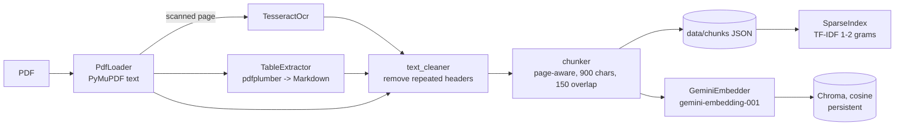
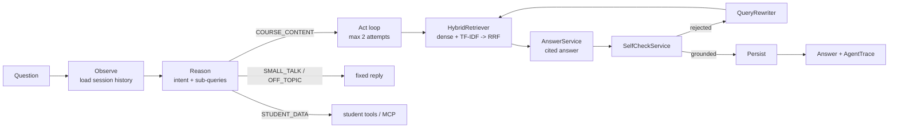

# Technical Design & Evaluation Report (DRAFT)

DS205.3 Explainable Agentic RAG, Shine AI Service. Max 3,000 words.

> Draft status: sections I–IV and VI are a technical first draft written from the code. The team must edit them into its own words, add references (APA/Harvard), and write Section V itself. Section IV needs numbers from a real live run: do not paste `--mock` output.

## I. Problem Statement (ca. 500 words)

*To write.* Points the code supports:
- Domain: a training institute whose students ask questions about lecture PDFs, their timetable, invoices and attendance.
- A plain LLM answers from memory, so it can state things the course never said and cannot cite a page.
- A black-box RAG framework hides how a chunk was chosen. Here the retrieval score is decomposed: TF-IDF dot product, vector magnitudes and cosine per chunk, the per-term contributions, and the dense similarity, then the Reciprocal Rank Fusion that combines them.
- Single-shot RAG cannot handle "compare X and Y" or a query whose first retrieval fails. The agent plans, retrieves per sub-query, checks its own answer and retries once.

## II. System Architecture & Mathematical Foundations (ca. 800 words)

Points to cover (with the file that implements each):
- **Layers and DI.** `app/domain/ports` (ABCs: `Retriever`, `Embedder`, `VectorStore`, `LLMClient`, `ChatStore`, `SparseIndexer`, `OcrEngine`), `app/infrastructure` (adapters), `app/services` (use cases), `app/container.py` (constructor injection).
- **Chunking** (`chunker.py`): never spans a page, so a citation is exact; paragraphs, then sentences, then a hard split; overlap of whole sentences; tables are their own chunks with the header repeated.
- **Sparse math** (`sparse_index.py`): `TfidfVectorizer(norm=None)` keeps raw weights; `dot = d·q`, `|v| = sqrt(sum w²)`, `cosine = dot / (|q||d|)` computed explicitly; `explain_terms` lists the per-term products that sum to the dot product.
- **Dense** (`embedder_gemini.py`, `chroma_vector_store.py`): `gemini-embedding-001`, Chroma HNSW in cosine space; similarity = 1 − distance.
- **Fusion** (`hybrid_retriever.py`): `RRF(d) = Σ 1 / (60 + rank_i(d))` over the dense and sparse lists. RRF uses ranks, so the two score scales need no calibration.

## III. Implementation & Traceability (ca. 600 words)

*To write from a real run.* Use the output of
`python -m app.cli ask "What is the software crisis, and how does software differ from a program?" --show-math`, which prints `[OBSERVE]`, `[REASON]`, `[PLAN]`, `[RETRIEVE]` (RRF, dense and TF-IDF scores, the worked example), `[LOOP]`, `[CHECK]`, `[ANSWER]`. Describe:
- Observe: `ObserveStage` loads the last 6 messages of the session.
- Reason: `ReasonStage` returns intent, reason and optional sub-queries (JSON mode); falls back to COURSE_CONTENT on error.
- Act: `ActStage._handle_course_content`, bounded by `MAX_ATTEMPTS`, with `AgentTrace` as the state record.
- Persist: `PersistStage` stores the turn and citations in SQLite.
- Retrieved versus generated: show the trace hits next to the answer's `[S#]` citations.
- Honest limits: the retry is triggered by retrieval returning nothing or by a self-check rejection (which can also be caused by an API failure).

## IV. Empirical Evaluation (ca. 600 words)

*Run first, then paste.* `python -m app.cli eval --config all --output report.md` (and `--config hybrid_with_self_check` for the per-query table). Include at least 10 rows with the full response and Context Relevance, Groundedness and Answer Relevance, the ablation table, and a discussion of failures (false refusals, a hallucination the self-check caught, retrieval misses). Metric definitions: `docs/EVALUATION.md`.

## V. Personal Reflection (ca. 400 words)

*To be written by each student in their own words.*

## VI. Future Work (ca. 300 words)

Candidates grounded in the code:
- A cross-encoder re-ranker on the top 10 fused hits.
- A tool-routing agent that chooses between document search, student data and a calculator rather than one intent label.
- Using the LLM judge's claim-level output to highlight unsupported sentences in the UI.
- Scaling: move the TF-IDF index out of process memory (it is rebuilt from `data/chunks` at start-up), batch embeddings, and shard Chroma per course.
- Multimodal PDFs: slide figures and diagrams are currently lost; OCR only handles text.
